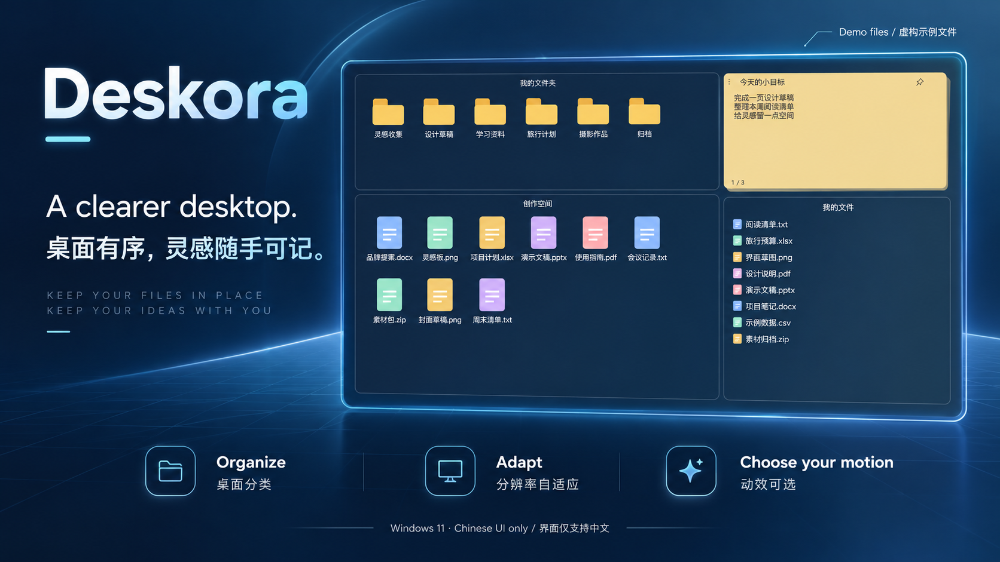
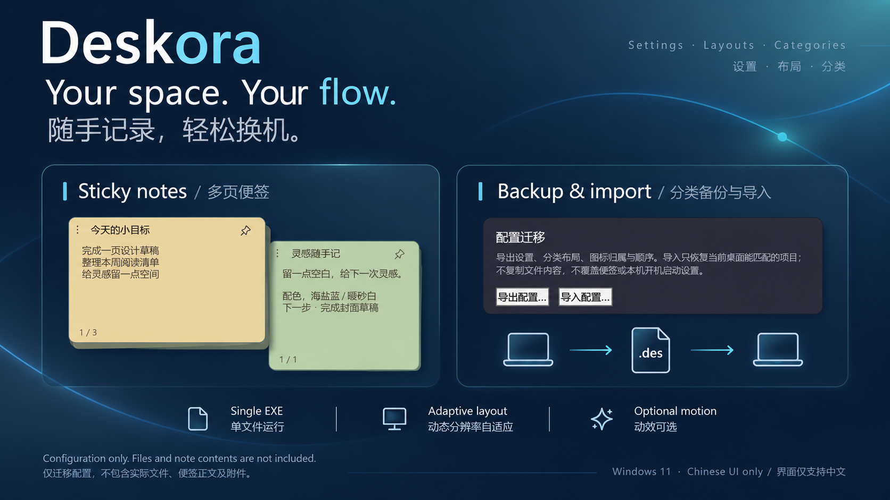
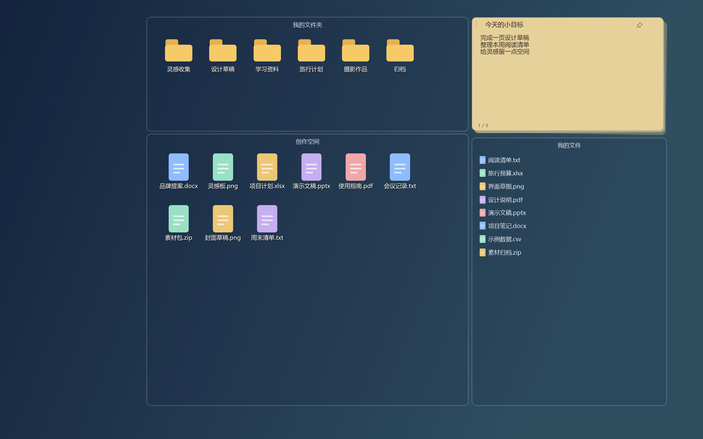
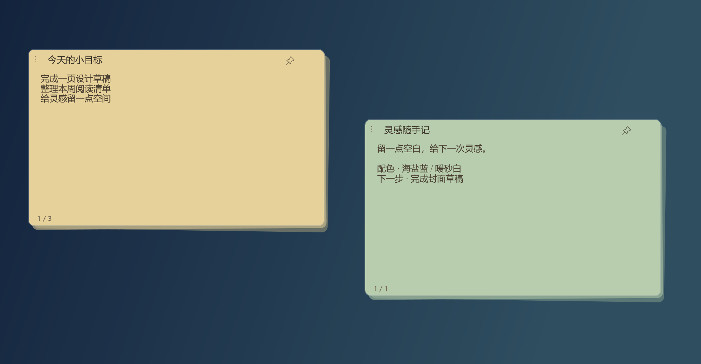

# Deskora — Desktop Organizer｜桌面整理

**A clearer desktop. A little more room for ideas.**  
**让桌面井然有序，让灵感随手可记。**

Windows 11 · x64 · Single EXE / 单文件运行  
**Chinese UI only / 软件界面目前仅支持中文**

[Download / 下载最新版](https://github.com/fnick6800/Deskora/releases/latest) · [中文介绍](#中文介绍) · [English](#english) · [Usage & rights / 使用与版权](NOTICE.md)

## 中文介绍

Deskora 是一款面向 Windows 11 的原生桌面整理工具。用透明分类格整理文件，用便签记录想法，让桌面保留熟悉的操作方式，也更容易找到正在做的事。

### 你会用到的功能

| 功能 | 体验 |
| --- | --- |
| 桌面分类 | 图标与列表视图，自由拖动、调整大小和吸附；分类只记录归属，不因归类而移动或复制实际文件。 |
| 轻量设计 | 原生 WPF、单文件 EXE，无需另装 .NET 运行时；实际下载大小见 Releases。 |
| 动态分辨率自适应 | 根据分辨率、系统缩放和可用空间调整布局，适应不同桌面尺寸。当前版本以单屏桌面为范围。 |
| 动效可选 | 柔和、暴力、无，按喜好选择；动画反馈不改变回收站与永久删除的实际操作含义。 |
| 多页便签 | 随手记录、滚轮翻页，支持富文本、图片与单页固定。 |
| 分类备份与导入 | 将设置、布局、分类归属和排序导出为 `.des` 配置包，换机后导入并匹配新电脑已有的桌面项目。 |
| 桌面搜索 | 快速查找桌面文件，减少翻找。 |

### 开始使用

1. 前往 [Releases](https://github.com/fnick6800/Deskora/releases/latest)，下载最新的 `Deskora-版本-win-x64.exe`。
2. 将 EXE 放在准备长期保留的位置，双击运行；无需另装运行时。
3. 根据首次引导选择是否导入桌面项目。通过桌面右键的 **Deskora** 菜单管理显示、分类及设置。
4. 在设置中选择动效，按需要显示或隐藏便签及其他桌面组件。

### 换机时怎样保留分类

1. 在旧电脑打开 **设置 → 配置迁移 → 导出配置**，保存 `.des` 文件。
2. 自行把需要的真实文件复制到新电脑桌面。
3. 在新电脑运行 Deskora，选择 **导入配置**，查看预览后确认。

配置包包含设置、分类布局、图标归属与顺序，**不包含实际文件、便签正文或附件**。导入仅匹配当前桌面已存在的项目，缺失或无法唯一匹配的项目会跳过；不会覆盖便签或本机开机启动设置。导入前自动保留一份配置备份。

### 真实界面示例

以下图片使用软件原生控件渲染，全部文件名、便签内容和图标均为专门制作的演示数据，没有使用作者的真实桌面内容。上方宣传图基于这些截图制作，并包含 AI 辅助视觉排版。

查看更多：多页便签与配置迁移

### 使用范围

软件目前仅支持中文界面；本页同时提供中英文介绍。当前版本不提供扩展显示器的独立多屏布局。配置与便签保存在当前 Windows 用户的 `%APPDATA%\Deskora`，删除 EXE 不会删除这些数据。

本仓库提供产品介绍和可下载的正式版本，**暂不公开源码**。可免费用于个人非商业用途；未经授权，禁止商业使用及营利行为。完整说明见 [NOTICE](NOTICE.md)。

## English

Deskora is a native desktop organizer for Windows 11. Arrange files in transparent category panels, keep quick notes close at hand, and adapt your workspace to the available screen area.

**The application interface is currently available in Chinese only.** This page is bilingual; it does not indicate an English-language application build.

### Features

- **Desktop categories.** Icon and list views, movable and resizable panels, and snapping. Classification stores metadata without moving or copying your files.
- **A simple native app.** One self-contained EXE, with no separate .NET runtime installation. See Releases for the actual download size.
- **Adaptive layout.** Responds to resolution, display scaling and available space. The current version focuses on a single desktop display, rather than independent extended-monitor layouts.
- **Optional motion.** Choose gentle effects, playful monster effects, or none. Visual feedback does not change the distinction between recycling and permanent deletion.
- **Multi-page sticky notes.** Quick notes, wheel-based page switching, rich text, images and pinned pages.
- **Category backup and import.** Export settings, layouts, category assignments and ordering to a `.des` file, then match existing desktop items on another PC.
- **Desktop search.** Find files on your desktop quickly.

### Get started

Download the latest `Deskora-<version>-win-x64.exe` from [Releases](https://github.com/fnick6800/Deskora/releases/latest), keep it in a stable location and run it. No separate runtime is required. Follow the first-run guide and use the desktop **Deskora** context menu to access settings and categories.

### Moving to a new PC

Export the configuration on the old PC, transfer your actual files separately, and import the `.des` configuration on the new PC. Review the import preview before applying it.

**Configuration packages do not include actual files, note contents or attachments.** Missing or ambiguous matches are skipped. Import preserves existing notes and the local startup setting, and retains one pre-import configuration backup.

All screenshots use production controls with fictional filenames, notes and custom sample icons. Promotional artwork uses these screenshots with AI-assisted visual composition. No personal desktop content is shown.

This repository hosts product information and official downloads; source code is not published. **Free for personal, non-commercial use. Commercial use and profit-making activities require authorization.** See [NOTICE](NOTICE.md) for the complete usage and third-party attribution information.

---

Copyright © 2026 WYS. All rights reserved / 保留所有权利。
